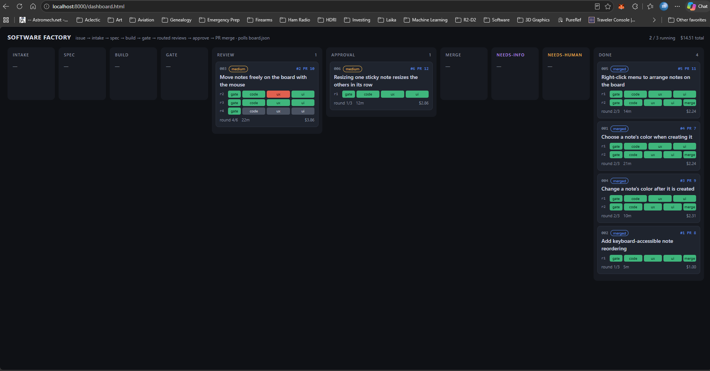

# simple-software-factory-v2

A small, visual software factory for Claude Code that works through your
GitHub issues. Label an issue `factory` and run `/factory run`: an intake
agent decides whether it's worth building and how risky it is, agents write a
spec and build it in its own git worktree, your own test suite gates every
build, the reviewers that the risk calls for review it, and the approver
merges the pull request or hands it to you.

It's one Claude Code skill, eight subagents, three small Python scripts and
markdown files. Everything fits in a few minutes of reading.

## Install into a project

The easiest way is to let Claude Code do it. In your project, ask:

```text
Install the software factory from https://github.com/michael-muir/simple-software-factory-v2
following its INSTALL.md.
```

The agent runs the installer, writes `factory/checks.sh` with your project's
real test, lint, typecheck and build commands, checks they pass on your
default branch, writes repo notes that tailor the reviewers to your stack,
and creates the GitHub labels. See [INSTALL.md](INSTALL.md).

By hand:

```sh
git clone https://github.com/michael-muir/simple-software-factory-v2.git
./simple-software-factory-v2/install.sh /path/to/your-project
```

Then, in your project:

1. Put your real checks in `factory/checks.sh` and run `factory/bin/gate --main`
   until it prints `GATE: PASS`.
2. In `factory/config.json`, set `base_branch` to your default branch,
   and `merge_method` to one your repo allows. `concurrency` (how many jobs
   run at once) is 3 unless you change it.
3. Run `factory/bin/board init` to create the GitHub labels.
4. Commit the install on your default branch and push it. Every job branches
   from `origin/<base_branch>`, so the factory must be there first.

The installer refuses to overwrite existing files unless you pass `--force`;
`--dry-run` shows what it would do. `factory/repo.md` (repo notes for the
agents) is written on the first run if the install didn't write it.

### Requirements

- Claude Code 2.1.257 or later (the intake agent runs on Fable)
- `git`, `bash` and `python3` 3.9 or later. On Windows, use Git Bash or WSL.
- An authenticated [`gh`](https://cli.github.com/) that can push to the repo
  and manage its labels

## First run

1. Open a new Claude Code session in your project's root, so it loads the
   factory's skill and agents.
2. Pick one small, clear issue and add the `factory` label to it.
3. Run `/factory run`. To start from an idea instead of an issue, add a line
   like `- [ ] Add a --verbose flag` to `factory/backlog.md` and run
   `/factory next`.
4. Watch it on the dashboard (see [Dashboard](#dashboard)).
5. Each job ends as a pull request. The approver merges what it's sure of.
   The rest are labeled `factory:needs-human`: merge the PR to approve it, or
   run `/factory rework <id> <what to change>`.

If intake has a question, it asks on the issue. Answer there (or with
`/factory <your answer>`), then run `/factory run` again.

## Upgrade in place

```sh
git -C simple-software-factory-v2 pull
./simple-software-factory-v2/install.sh --upgrade /path/to/your-project
```

An upgrade replaces the factory's own files (the skill, agents, scripts and
dashboard), removes any the new version no longer ships, and leaves your
project's files alone: `config.json`, `checks.sh`, `backlog.md`, `repo.md`
and `factory/jobs/` are never touched. It won't run while jobs are in
progress unless you pass `--force`. The installed version is recorded in
`.claude/skills/factory/.factory-version`.

Coming from the older local-merge version? `factory/board.json` is now
generated and gitignored (the installer tells you to `git rm --cached` it),
and the factory now needs `gh` and a GitHub `origin`.

## How it works

```
GitHub issue labeled `factory`
        │
        ▼
     intake (fable) ── NEEDS-INFO → question posted on the issue; job parks until the author answers
        │              REJECT     → reason posted on the issue; `factory` label taken off
        ▼ ACCEPT (maybe cut down), risk + surfaces
     route (script) → reviewers and models from config.json
        ▼
   spec-writer (opus) → spec.md
        ▼
     builder (opus) → commits in .worktrees/<id>; the script pushes and opens a draft PR "Closes #n"
        ▼              ▲
     gate (script) ─FAIL─┤   factory/checks.sh; no reviewer runs on a failing build
        ▼ PASS           │
   reviewers ─CHANGES────┘   code always; + security, ux, ui when routed. WAIT FOR ALL.
        ▼ all PASS           (max 3 rounds)
    approver (opus) ── APPROVE  → board merge: merge main in, re-run the gate, gh pr merge
                    └─ ESCALATE → needs-human: PR marked ready, decision posted, issue labeled
```

The session running `/factory` is the **orchestrator**. It spawns every
agent and runs the scripts, and it never writes code, reviews or state
itself. Agents get context from files, not the conversation, and each writes
exactly one file that opens with a verdict line and a `## Summary`.

**Scripts decide what's deterministic; agents judge the rest.**

- `factory/bin/board` is the only writer of job state. Each job has its own
  `factory/jobs/<id>/job.json`; after every write the script rebuilds
  `factory/board.json`, the index the dashboard reads. It refuses moves the
  pipeline doesn't allow (no review before a passing gate, no approval until
  every reviewer is in, no new round past the limit), enforces
  `concurrency`, pushes branches, opens PRs, posts on issues, and merges.
- `factory/bin/gate` runs `factory/checks.sh` in the job's worktree before any
  reviewer starts, and again after syncing with `main` before the merge. It
  always runs the **main checkout's** copy of `checks.sh`, so a branch can't
  change the checks it's judged by, and it fails any branch that touches a
  `protected_paths` entry (`factory/`, `.claude/`). The builder also has a
  stop hook that runs the checks before it can finish.
- `factory/bin/route` maps intake's risk and surfaces to reviewers and
  models, using the `reviewers` rules in `config.json`:

  | | code | security | ux | ui |
  |---|---|---|---|---|
  | low risk | haiku | | | |
  | medium risk | sonnet | | | |
  | high risk | sonnet | opus | | |
  | `ui` surface | | | sonnet | sonnet |
  | `security` surface | | opus | | |

**Safety.** Only issues labeled `factory` run, and only people with triage or
write access can add labels. Issue text reaches agents only as quoted data in
`issue.md`, with comments from the issue's author and the operator only; the
intake agent that reads it first has no shell. The factory pushes only
`factory/*` branches, merges only through `gh pr merge` (so branch protection
and required checks apply), and never deploys. Each job gets at most
`max_rounds` rounds before a human is asked.

**State is files, so runs resume.** If the session dies, `/factory run` reads
`factory/jobs/` and picks every job back up from its stage.

## Commands

- `/factory run`: work through every open `factory` issue, `concurrency` at a
  time (default 3); also resumes unfinished jobs.
- `/factory run <n>`: run issue `#<n>` now.
- `/factory next [n]`: file the first `n` unchecked lines of
  `factory/backlog.md` as `factory` issues and run them.
- `/factory approve <id>`: merge a `needs-human` job's PR. (Merging it on
  GitHub does the same; the factory notices.)
- `/factory rework <id> [note]`: send a `needs-human` job back to a fresh
  builder with your note (or, with none, to fix why it stopped), with a fresh
  round budget.
- `/factory reject <id> <reason>`: drop a job waiting on you or its author;
  the reason goes on the issue and the PR closes.
- `/factory <anything else>`: ask about jobs or costs, answer an intake
  question, or describe a new feature (it becomes an issue).

## Dashboard



To launch the dashboard, run `board serve` from your project's root (not from
inside `factory/`), then open http://localhost:8000/dashboard.html.

**Git Bash (Windows), macOS or Linux:**

```sh
factory/bin/board serve
```

**PowerShell or Command Prompt (Windows):**

```powershell
python factory/bin/board serve
```

PowerShell can't run `factory/bin/board` by itself (Windows asks which app to
open it with), so start it through `python`. Stop it with Ctrl+C. If port
8000 is taken, add another port, e.g. `factory/bin/board serve 8001`, and open
that port instead.

If `board serve` won't start, you can serve the folder as plain files. The
board still shows, but costs only update when a job changes stage, and there
are no Approve, Rework or Reject buttons:

```sh
cd factory
python -m http.server 8000     # python3 on macOS and Linux
```

Each job is a card with its issue and PR links, risk, a row of chips per round
(the gate, then each routed reviewer, then the merge gate), cost and time.
Costs update while agents work, per job and in the factory total at the top.
They count the job's agents, not the session that runs the factory.
Jobs waiting on you or on an issue's author stand out. Click a card to read
every file the job wrote, each one led by its summary, plus the job's history.

With `board serve`, a job waiting on you has **Approve**, **Rework** and
**Reject** buttons at the top of its card's popup (**Reject** only, for a job
waiting on its author). They do the same as `/factory approve`, `rework` and
`reject`. A running `/factory run` session picks up a rework right away;
otherwise the next `/factory run` does. The buttons only work from the page
`board serve` gives you, on your own machine.

Cost is the API-equivalent price of each job's agents, read from Claude
Code's transcripts and priced with `prices_usd_per_mtok` in `config.json`. On
a subscription it shows where the spend goes, not what you're billed. Claude
Code doesn't promise a stable transcript format; if a release changes it, the
cost shows as unknown and everything else carries on.

## Cost and safety notes

- It opens and merges real PRs on your Claude plan, up to 3 jobs at once by
  default. To start carefully, set `"concurrency": 1` and review each PR
  yourself until it has earned your trust.
- Intake runs on Fable once per issue (and again after an author's reply).
  Depending on your plan, Fable can bill to usage credits; set `model: opus`
  in `.claude/agents/intake.md` if you prefer.

## Layout

```
install.sh                        install into / upgrade a project (this repo only)
INSTALL.md                        install instructions for a coding agent (this repo only)
.claude/skills/factory/SKILL.md   the orchestrator's instructions
.claude/agents/*.md               intake, spec-writer, builder, review-{code,security,ux,ui}, approver
factory/bin/board                 job state: the only writer of job.json and board.json
factory/bin/gate                  runs checks.sh on a job's branch (+ the builder's stop hook)
factory/bin/route                 risk + surfaces → reviewers and models
factory/config.json               concurrency, rounds, labels, routing, protected paths, prices
factory/checks.sh                 your project's checks (filled in at install)
factory/dashboard.html            the visual board
factory/backlog.md                ideas for /factory next
factory/repo.md                   repo notes and review focus, written at install or first run
factory/board.json                generated index for the dashboard (gitignored)
factory/jobs/<id>/                job.json, issue.md, intake.md, spec.md, build.md,
                                  rework-K.md, round-N/, decision.md (gitignored)
.worktrees/<id>/                  a job's code, on factory/<id> (gitignored)
```

To change the factory, edit `SKILL.md` (the loop), the agent files (the
workers), `config.json` (routing and limits), or the scripts (the rules).
